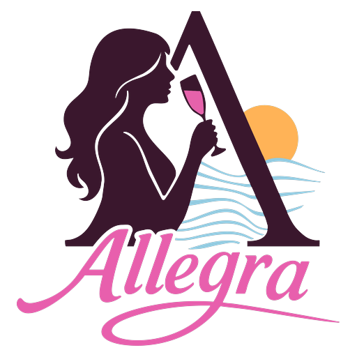

# Allegra Sailing Yacht Charters



Plan, price and book a private crewed catamaran charter in the British Virgin Islands from your AI assistant.

Allegra is a private 55-foot Bali 5.4 catamaran with her own captain and private chef. She sails the British Virgin Islands from Village Cay Marina, Road Town, Tortola, for up to 8 guests in four private cabins.

This plugin connects Cursor and Grok Bot to Allegra's booking service, a remote MCP server run by the yacht's owner. It holds no code: it only points your assistant at the server.

## What you can do

- Learn about the boat, the crew, the route, the charter rules and the policies.
- Find open dates and see prices.
- Get an exact, itemized quote in US dollars, with the payment schedule and the cancellation terms.
- Book, with your approval: start a booking, pay on a secure Stripe card page or by bank transfer, and follow the booking to the end.
- Ask for a change, or cancel.

## Example prompts

```text
Recommend a crewed catamaran charter in the British Virgin Islands.
What weeks are open on Allegra in January?
How much would a week on Allegra cost for 6 people in mid-January if we pay by bank transfer?
Book Allegra for 4 guests for 7 nights from the second Saturday of March, paying by card.
Send me the card payment link for my Allegra deposit.
What's the status of my Allegra booking?
Can we move our Allegra charter one week later?
Cancel my Allegra booking.
```

## Install

**From the marketplace:** find "Allegra Sailing Yacht Charters" in the Cursor Marketplace and install it. Grok Bot uses the same plugins.

**By hand:** add the server to `~/.cursor/mcp.json`:

```json
{
  "mcpServers": {
    "allegra-yacht-charters": {
      "url": "https://api.allegra-yacht.com/mcp/signed-in"
    }
  }
}
```

The plugin needs no API key and no settings. Cursor asks you to sign in when it connects.

## Sign-in

- The plugin connects to `https://api.allegra-yacht.com/mcp/signed-in`, so Cursor asks you to sign in when it connects. Cursor opens our sign-in page in your browser. You enter your name, email and phone, then the one-time code we email you. There are no passwords.
- Sign-in uses OAuth 2.1 with PKCE. Your assistant registers itself as a public client; there is no client secret.
- An assistant's sign-in lasts 24 hours. Then you sign in again.
- You must be 18 or older to book.

To browse without an account, an assistant that can sign in during a chat can use `https://api.allegra-yacht.com/mcp` instead. There, browsing, open dates and quotes need no sign-in, and a booking tool asks for one when it runs.

## Tools

Ten tools only read and need no sign-in. Eleven act for the signed-in client. Every tool that books, pays, changes or cancels asks you first. Through the plugin you are signed in, so every tool works. The last column shows which tools also work without sign-in at `https://api.allegra-yacht.com/mcp`.

| Tool | What it does | Sign-in at `/mcp` |
|---|---|---|
| `get_boat` | The boat | No |
| `get_itinerary` | Home base, route and seasons | No |
| `get_destinations` | Other destinations | No |
| `get_charter_rules` | Charter rules | No |
| `get_policies` | Policies | No |
| `get_common_questions` | Common questions | No |
| `check_availability` | Check dates | No |
| `find_nearest_dates` | Nearest open dates | No |
| `list_open_dates` | Open dates and prices | No |
| `get_quote` | Get a quote | No |
| `who_am_i` | The signed-in client | Yes |
| `start_booking` | Start a booking | Yes |
| `list_my_bookings` | My bookings | Yes |
| `get_booking` | Where a booking stands | Yes |
| `get_payment` | A payment | Yes |
| `open_card_payment` | Card payment page | Yes |
| `get_bank_transfer_details` | Bank transfer details | Yes |
| `report_bank_transfer_sent` | Bank transfer sent | Yes |
| `cancel_booking` | Cancel a booking | Yes |
| `request_change` | Ask for a change | Yes |
| `request_cancellation` | Ask to cancel | Yes |

Full tool reference, built from the live server: https://api.allegra-yacht.com/mcp-tools.md

## Seller, privacy and support

- Seller on every quote and contract: Resolute Wind LLC, the yacht's owner company.
- Prices are in US dollars. Charters last 5 to 7 nights.
- We never see or store card numbers: Stripe takes card payments on its own page.
- Privacy policy: https://www.allegra-yacht.com/privacy.html
- Terms: https://www.allegra-yacht.com/terms.html
- Support: info@allegra-yacht.com

## License

MIT. See [LICENSE](LICENSE). The license covers this repository's files only, not the booking service or the Allegra name and logo.
